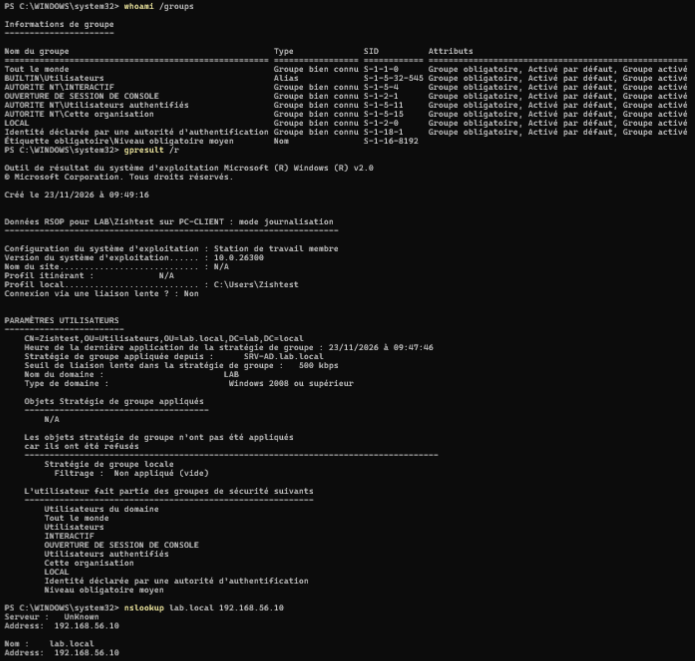
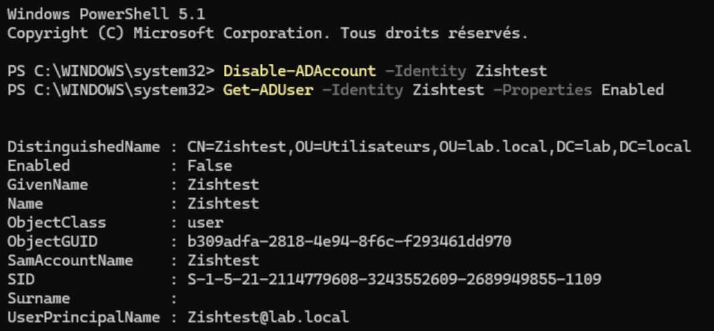
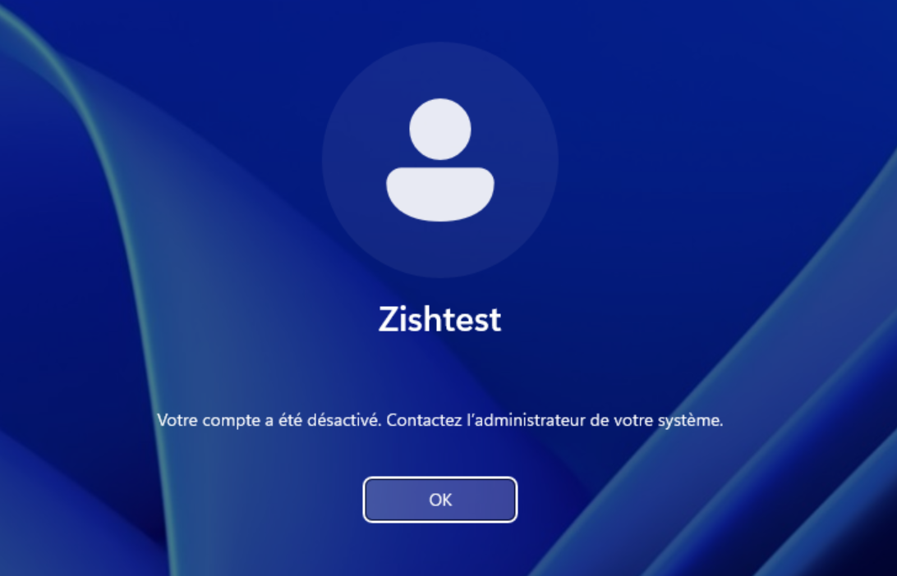
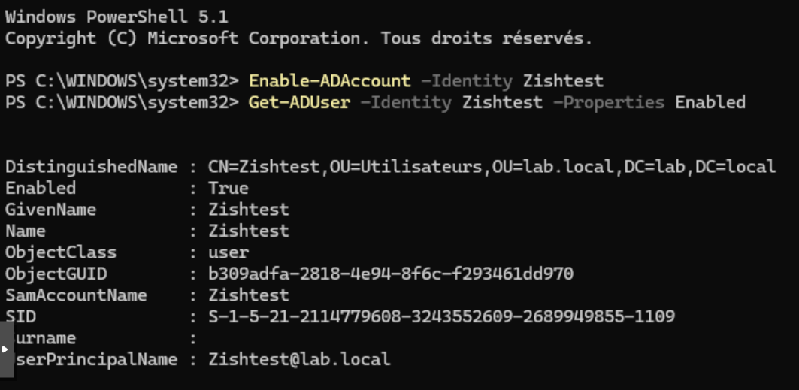

# Fiche incident N1 - Compte désactivé

Projet Support N1/N2 et virtualisation - Semaine 1 - J05 H3
Technicien : ASLAM Zishan - Date : 23/11/2026
Domaine : lab.local - Machine concernée : PC-CLIENT (192.168.56.20)

---

## Contexte

Intervention N1 simulée sur un poste membre du domaine. L'objectif est de distinguer un problème d'identité (compte) d'une panne réseau, de le résoudre et de le tracer.

## Symptôme

L'utilisateur ne peut plus ouvrir de session sur PC-CLIENT. Message affiché à l'écran de connexion : "Votre compte a été désactivé. Contactez l'administrateur de votre système."

## État de départ (session saine, avant incident)

Avant l'incident, la session du compte de test Zishtest fonctionne normalement : appartenance au domaine LAB, GPO récupérées depuis SRV-AD.lab.local, résolution DNS de lab.local vers 192.168.56.10.



## Diagnostic

Vérification de l'état du compte dans l'Active Directory depuis SRV-AD :

```powershell
Get-ADUser -Identity Zishtest -Properties Enabled
```

Résultat : `Enabled : False`. Le compte est désactivé dans l'annuaire. Ce n'est ni une panne réseau, ni une erreur de mot de passe.



Confirmation côté poste : la tentative de connexion renvoie bien le message de compte désactivé.



## Cause

Compte utilisateur désactivé dans l'Active Directory.

## Action de remédiation N1

Après vérification de l'identité du demandeur, réactivation du compte depuis SRV-AD :

```powershell
Enable-ADAccount -Identity Zishtest
Get-ADUser -Identity Zishtest -Properties Enabled
```

Résultat : `Enabled : True`. Le compte est réactivé.



## Validation

L'utilisateur se reconnecte avec succès sur PC-CLIENT : la session s'ouvre normalement.


## Procédure N1 à retenir

1. Vérifier l'identité du demandeur avant toute action sur son compte.
2. Contrôler l'état du compte dans l'AD : `Get-ADUser -Identity <login> -Properties Enabled,LockedOut,PasswordExpired`.
3. Appliquer la remédiation autorisée : `Enable-ADAccount` (désactivé) ou `Unlock-ADAccount` (verrouillé).
4. Faire valider l'utilisateur par un test de reconnexion.
5. Ne jamais écrire de mot de passe dans la fiche ou le ticket.

---

## Captures

| Fichier | Contenu |
|---|---|
| captures/j05h3scr1.png | Session saine avant incident |
| captures/j05h3scr2.png | Compte désactivé (Enabled False) |
| captures/j05h3scr3.png | Message de refus à la connexion |
| captures/j05h3scr4.png | Compte réactivé (Enabled True) |
| captures/j05h3scr5.png | Reconnexion réussie |
