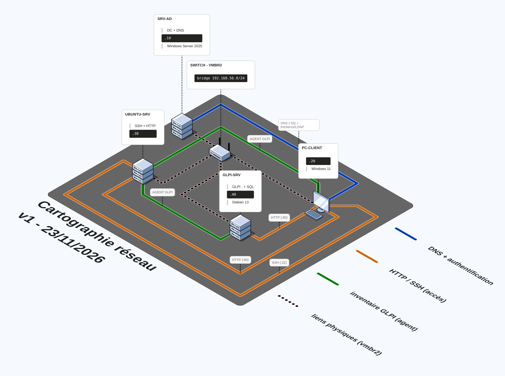

# Projet 3 semaines - Support N1/N2 et virtualisation

AIS - RNCP37680 - CP1 - Formateur : Mohamed Amine Harabi
Durée : 3 semaines - 21 jours - 63 heures - En groupe

Construction d'un laboratoire de 4 machines virtuelles sur Proxmox, montée en compétence du support N1 vers le support N2 : infrastructure (AD/DNS, Windows, Linux), centre de services GLPI, puis sécurité, sauvegardes et gestion des changements.

---

## Architecture du laboratoire



| Machine | Rôle | IP (Host-Only) | OS |
|---|---|---|---|
| SRV-AD | AD DS + DNS | 192.168.56.10 | Windows Server 2025 |
| PC-CLIENT | Poste membre du domaine | 192.168.56.20 | Windows 11 |
| UBUNTU-SRV | SSH + HTTP | 192.168.56.30 | Ubuntu Server |
| GLPI-SRV | GLPI + SQL | 192.168.56.40 | Debian 13 |

Réseau : 192.168.56.0/24, mode Host-Only (bridge Proxmox vmbr2), isolé, sans passerelle. DNS du domaine : SRV-AD (192.168.56.10). Domaine : lab.local. Mises à jour via un adaptateur NAT secondaire ponctuel. L'AD et GLPI ne sont jamais exposés à Internet.

Hyperviseur : Proxmox VE 9 - pool projets-ais.

---

## Répartition des rôles

| Domaine / Machine | Responsable |
|---|---|
| SRV-AD (AD DS, DNS, GPO) | [à compléter] |
| PC-CLIENT (poste, incidents, droits) | [à compléter] |
| UBUNTU-SRV (SSH, web, services) | [à compléter] |
| GLPI-SRV (GLPI, inventaire, tickets, SLA) | ASLAM Zishan |
| Cartographie réseau | ASLAM Zishan |
| Transverse (sécurité, sauvegardes, documentation) | [à compléter] |

---

## Structure du dépôt

```
Projet-3-semaines-AIS/
├── README.md
├── CHECKLIST_PREUVES.md        Suivi des preuves J01 à J21
├── S1-Infrastructure/
│   ├── 01_Architecture/        Schéma réseau, plan IP
│   ├── 02_Configurations_VM/
│   ├── 03_AD_DNS/              Comptes, incidents AD
│   ├── 04_Ubuntu/
│   ├── 05_Snapshots/
│   └── 06_Rapport_S1/
├── S2-GLPI/
│   ├── 01_Installation_GLPI/
│   ├── 02_Exports_inventaire/
│   ├── 03_Tickets_N1/
│   ├── 04_SLA/
│   ├── 05_Base_Connaissances/
│   └── 06_Rapport_S2/
└── S3-Support-N2/
    ├── 01_Clones_Restauration/
    ├── 02_Incidents_N2/
    ├── 03_Securite/
    ├── 04_Sauvegardes/
    ├── 05_Changement/
    └── 06_Rapport_Final/
```

---

## Conventions

- Nommage des fichiers : `SX_JXX_description.ext` (ex : `S1_J05_fiche_incident_compte.md`).
- Chaque référent dépose ses preuves dans le dossier de son domaine.
- Avant chaque séance : snapshot si l'activité modifie un service, et journal de manipulation (commande, résultat, hypothèse, action, preuve).
- Dépôt public : aucun mot de passe ni secret dans les fichiers.
