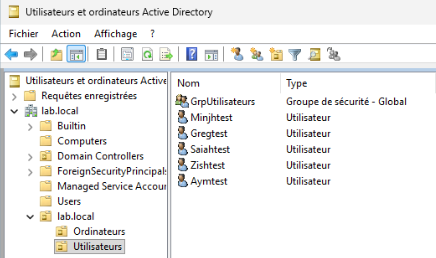

# Comptes AD et poste client - Configuration et jointure

Projet Support N1/N2 et virtualisation - Semaine 1 - J05 (H1 / H2)
Technicien : [Nom Prénom] - Date : 23/11/2026
Domaine : lab.local - Poste concerné : PC-CLIENT (192.168.56.20) - Serveur : SRV-AD (192.168.56.10)

---

## Contexte

Préparation du poste client Windows 11 (PC-CLIENT) : configuration réseau, renommage, puis jointure au domaine lab.local. Création des comptes de test et des groupes de sécurité côté Active Directory. L'objectif est d'avoir un poste membre du domaine, capable de résoudre les noms et de s'authentifier auprès du contrôleur de domaine.

## H1 - Configuration réseau et renommage du poste

Le poste est configuré avec une adresse IP statique et pointe vers SRV-AD comme serveur DNS (indispensable pour trouver le domaine), puis il est renommé en PC-CLIENT.

```powershell
# Renommer le poste
Rename-Computer -NewName "PC-CLIENT" -Restart

# Adressage IP statique (adapter le nom de l'interface si besoin)
New-NetIPAddress -InterfaceAlias "Ethernet" -IPAddress 192.168.56.20 -PrefixLength 24
Set-DnsClientServerAddress -InterfaceAlias "Ethernet" -ServerAddresses 192.168.56.10
```

Point clé : le DNS du poste doit pointer vers 192.168.56.10 (le contrôleur de domaine), sinon la jointure au domaine échoue.

### Preuve : adressage et résolution DNS

```powershell
ipconfig /all
nslookup lab.local 192.168.56.10
```

On vérifie que PC-CLIENT a bien l'IP 192.168.56.20, le DNS 192.168.56.10, et que lab.local se résout vers 192.168.56.10.


## H2 - Jointure au domaine et comptes de test

Jointure de PC-CLIENT au domaine lab.local, puis création des comptes de test et groupes de sécurité côté SRV-AD.

```powershell
# Sur PC-CLIENT : joindre le domaine
Add-Computer -DomainName "lab.local" -Credential lab\Administrateur -Restart
```

```powershell
# Sur SRV-AD : créer un compte de test dans l'OU Utilisateurs
New-ADUser -Name "Zishtest" -SamAccountName "Zishtest" `
  -UserPrincipalName "Zishtest@lab.local" `
  -Path "OU=Utilisateurs,OU=lab.local,DC=lab,DC=local" `
  -AccountPassword (Read-Host -AsSecureString "Mot de passe") -Enabled $true
```

Précaution : on utilise uniquement des comptes et mots de passe de test, jamais d'identifiants réels.

### Preuve : jointure au domaine

Dans les Propriétés système (sysdm.cpl), le poste affiche bien son appartenance au domaine lab.local.


### Preuve : liste des comptes de test

```powershell
Get-ADUser -Filter * | Select-Object Name, Enabled
```



---

## Captures

| Fichier | Contenu |
|---|---|
| captures/j05_h1_ip_dns.png | ipconfig /all et nslookup lab.local |
| captures/j05_h2_jointure.png | Jointure de PC-CLIENT au domaine |
| captures/j05_h2_comptes.png | Liste des comptes de test dans l'AD |

---

Note : le H3 du J05 (simulation d'un refus d'accès et intervention N1) est documenté dans la fiche `S1_J05_fiche_incident_compte.md`.
