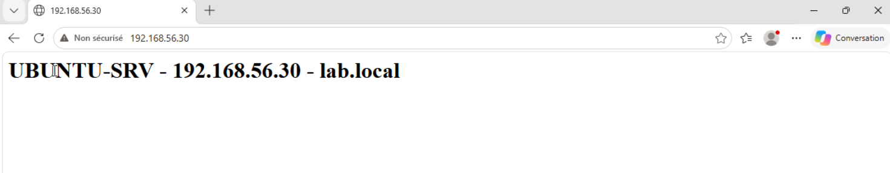
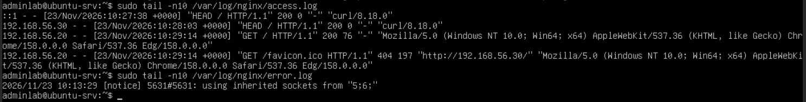
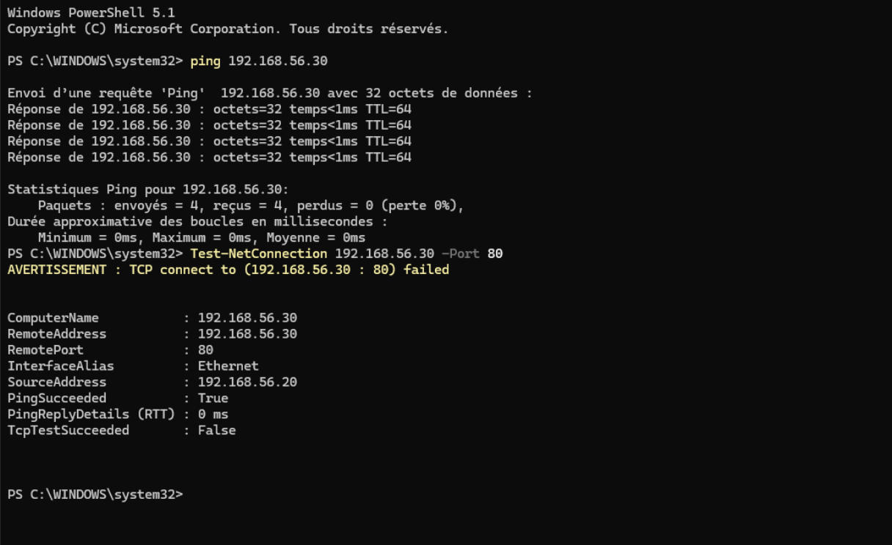
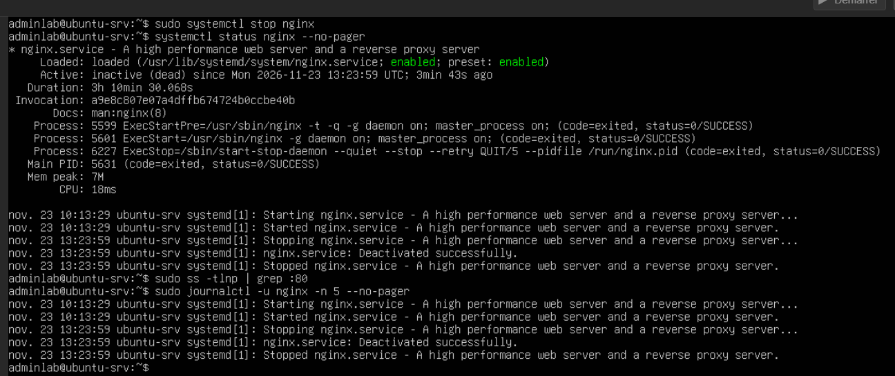
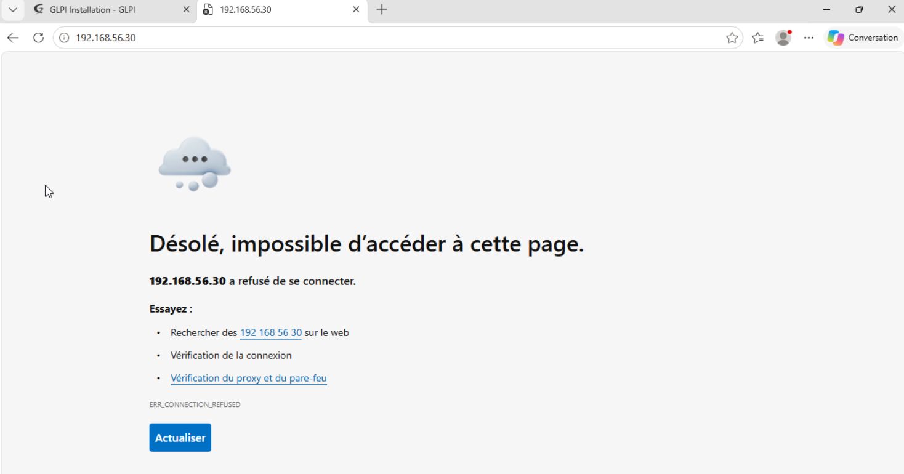

# J06 - UBUNTU-SRV : exploitation Linux

> Projet Support N1/N2 et virtualisation - Semaine 1
> Responsable : Grégory Datis - 23/11/2026
 
Le serveur UBUNTU-SRV est opérationnel : accès SSH technicien validé, Nginx en service et procédure de restauration testée. Le durcissement SSH et le compte standard restent à faire (H1).

## Sommaire
 
- [Contexte](#contexte)
- [H1 - Comptes, sudo et sécurisation SSH](#h1---comptes-sudo-et-sécurisation-ssh)
- [H2 - Service web Nginx](#h2---service-web-nginx)
- [H3 - Panne simulée et procédure de restauration](#h3---panne-simulée-et-procédure-de-restauration)
- [Auto-contrôle](#auto-contrôle)

---

## Contexte
 
| Élément | Valeur |
| --- | --- |
| Hyperviseur | Proxmox VE 9.2.11 (imbriqué dans VMware), nœud `pve` |
| Machine virtuelle | ID 208 - UBUNTU-SRV |
| Nom d'hôte | `ubuntu-srv` |
| Interface | `ens18`, pont `vmbr1` (réseau interne du lab) |
| Adresse IP | `192.168.56.30/24` (statique) |
| Passerelle | `192.168.56.254` |
| DNS | `192.168.56.10` (SRV-AD), `8.8.8.8` en secours |
| Domaine | `lab.local` |
| Services | SSH, Nginx |
 
Voisins sur le même réseau : SRV-AD (207, `.10`), PC-CLIENT (206, `.20`), GLPI-SRV (205, `.40`).

Voisins sur le même réseau : SRV-AD (207, `.10`), PC-CLIENT (206, `.20`), GLPI-SRV (205, `.40`).

---

## H1 - Comptes, sudo et sécurisation SSH
 
**Résultat :** le compte `technicien` (sudo) est créé et se connecte en SSH depuis PC-CLIENT. Le compte standard et le durcissement SSH restent à faire.
**Preuve attendue :** accès SSH validé et comptes.
 
> [!IMPORTANT]
> **Statut : partiel.** Fait : compte `technicien` + accès SSH validé. À faire : Durcissement SSH.

### Comptes
 
| Compte | Rôle | Groupe sudo | Statut |
| --- | --- | --- | --- |
| `adminlab` | Administrateur (créé à l'installation) | Oui | Fait |
| `technicien` | Technicien support | Oui | Fait |

Commandes réalisées :
 
```bash
sudo adduser technicien
sudo usermod -aG sudo technicien   # -a obligatoire : sans lui, le compte perd ses autres groupes
id technicien
getent group sudo
```

### Accès SSH validé
 
| Commande | Résultat |
| --- | --- |
| `ssh technicien@192.168.56.30` depuis PC-CLIENT | `Accepted password for technicien from 192.168.56.20` |


*Connexion de technicien acceptée depuis PC-CLIENT.*

### Reste à faire

**1. Durcissement SSH** dans `/etc/ssh/sshd_config.d/10-durcissement.conf`

> [!NOTE]
> Le préfixe `10-` fait lire ce fichier avant `50-cloud-init.conf`. Pour sshd, la première valeur lue l'emporte.

```
PermitRootLogin no
MaxAuthTries 3
LoginGraceTime 30
X11Forwarding no
AllowUsers adminlab technicien
```

| Paramètre | Justification |
| --- | --- |
| `PermitRootLogin no` | Connexion par compte nominatif puis sudo : traçabilité de qui fait quoi |
| `MaxAuthTries 3` | Coupe la session après 3 échecs, freine la force brute |
| `LoginGraceTime 30` | 30 s pour s'authentifier au lieu de 120 s |
| `X11Forwarding no` | Affichage graphique distant inutile sur un serveur |
| `AllowUsers` | Liste blanche : seuls les comptes d'administration se connectent |

```bash
sudo sshd -t              # test de syntaxe : aucune sortie = configuration valide
sudo systemctl restart ssh
sudo sshd -T | grep -Ei 'permitrootlogin|maxauthtries|allowusers|x11forwarding'
```

**3. Tests à capturer depuis PC-CLIENT** : `technicien` accepté, `root` refusés, puis `sudo journalctl -u ssh -n 2 --no-pager`.


## H2 - Service web Nginx
 
**Résultat :** Nginx 1.28.3 répond en HTTP 200 sur `192.168.56.30`, et PC-CLIENT accède à la page depuis Edge.
**Preuve attendue :** capture service HTTP et logs.

### Installation et vérification du service
 
Nginx a été choisi seul, sans Apache, pour éviter deux services en conflit sur le port 80.
 
```bash
sudo ss -tlnp | grep :80          # port 80 libre avant installation
sudo apt install -y nginx
systemctl status nginx --no-pager # active (running)
systemctl is-enabled nginx        # enabled : redémarre avec la VM
sudo ss -tlnp | grep nginx        # nginx en écoute sur 0.0.0.0:80
```
 
Page de test déposée avec `sudo tee`, car une redirection `>` derrière sudo s'exécute avec les droits de l'utilisateur et non de root :
 
```bash
echo "<h1>UBUNTU-SRV - 192.168.56.30 - lab.local</h1>" | sudo tee /var/www/html/index.html
```

### Tests HTTP
 
| Test | Résultat |
| --- | --- |
| `curl -I http://localhost` | `HTTP/1.1 200 OK`, `Server: nginx/1.28.3 (Ubuntu)` |
| `curl -I http://192.168.56.30` | `HTTP/1.1 200 OK`, `Content-Length: 48` (page de test) |
| Edge sur PC-CLIENT : `http://192.168.56.30` | Page affichée |
 

*Page de test ouverte dans Edge sur PC-CLIENT.*

### Logs
 
```bash
sudo journalctl -u nginx -n 10 --no-pager   # vie du service (systemd)
sudo tail -n 10 /var/log/nginx/access.log    # requêtes reçues
sudo tail -n 10 /var/log/nginx/error.log     # erreurs applicatives
```

`journalctl` indique si le service tourne. Les fichiers de `/var/log/nginx` indiquent ce qui se passe dans le service.

| Entrée access.log | Lecture |
| --- | --- |
| `::1 - HEAD / 200 - curl` | Test local (localhost en IPv6) |
| `192.168.56.30 - HEAD / 200 - curl` | Test sur l'IP du serveur |
| `192.168.56.20 - GET / 200 - Edge` | Accès réel depuis PC-CLIENT |
| `192.168.56.20 - GET /favicon.ico 404` | Icône d'onglet absente, sans impact |
| `192.168.56.20 - GET / 304` | Page servie depuis le cache du navigateur |
 

*access.log avec les requêtes de 192.168.56.20, error.log sans erreur.*

---

## H3 - Panne simulée et procédure de restauration
 
**Résultat :** l'arrêt de Nginx a été diagnostiqué sans toucher au réseau, puis le service a été rétabli et vérifié côté utilisateur.
**Preuve attendue :** procédure de restauration du service.
 
**Panne injectée :** `sudo systemctl stop nginx`

### Procédure de diagnostic et de restauration
 
Principe : partir de l'utilisateur et se rapprocher du service. Un service en échec ne signifie pas que le réseau est en panne.
 
1. Tester le réseau depuis le poste client : `ping 192.168.56.30`. Réponse OK : le réseau n'est pas en cause.
2. Tester le port web : `Test-NetConnection 192.168.56.30 -Port 80`. `TcpTestSucceeded : False`, donc rien n'écoute sur le port 80.
3. Vérifier l'état du service sur le serveur : `systemctl status nginx --no-pager`. État `inactive (dead)`.
4. Confirmer l'absence d'écoute : `sudo ss -tlnp | grep :80`. Aucune sortie.
5. Lire les logs : `sudo journalctl -u nginx -n 5 --no-pager`. La ligne `Stopped nginx.service` indique un arrêt propre et son heure, pas un crash.
6. Redémarrer le service : `sudo systemctl start nginx`.
7. Vérifier côté serveur : `systemctl status nginx` en `active (running)`, `curl -I http://192.168.56.30` en `200 OK`.
8. Vérifier côté utilisateur : rafraîchir Edge sur PC-CLIENT, la page s'affiche.
9. Contrôler le redémarrage automatique : `systemctl is-enabled nginx` renvoie `enabled`.

*Côté PC-CLIENT : PingSucceeded True, TcpTestSucceeded False. Le réseau fonctionne, le port 80 est fermé.*
 

*Côté serveur : nginx inactive (dead) depuis 13:23:59 UTC, ss vide, journal Stopped nginx.service.*
 
> [!TIP]
> Si le service passe en état `failed` au lieu de `inactive`, la cause est souvent la configuration : `sudo nginx -t` donne le fichier et la ligne en erreur. Toujours tester la configuration avant de relancer.
**Symptôme :** `http://192.168.56.30` ne s'affiche plus sur PC-CLIENT (Edge : `ERR_CONNECTION_REFUSED`, la machine répond mais refuse la connexion sur le port 80).
 

*Symptôme côté utilisateur.*

### Ticket brouillon
 
| Champ | Contenu |
| --- | --- |
| Titre | Site web UBUNTU-SRV inaccessible |
| Demandeur | Utilisateur PC-CLIENT |
| Catégorie | Incident > Serveur Linux > Service web |
| Impact / Urgence / Priorité | Moyen / Moyenne / P3 |
| Symptôme | `http://192.168.56.30` ne s'affiche plus depuis PC-CLIENT (23/11/2026 à 14:23:59 heure de Paris, soit 13:23:59 UTC dans les logs) |
| Diagnostic | Ping OK ; port 80 fermé ; nginx `inactive (dead)` ; journal : `Stopped nginx.service` |
| Cause | Service nginx arrêté manuellement |
| Résolution | `sudo systemctl start nginx` |
| Vérification | `active (running)`, curl `200 OK`, page affichée dans Edge |
| Durée | À compléter |
| Prévention | Service activé au démarrage ; surveiller le port 80 |
| Statut | Résolu |
