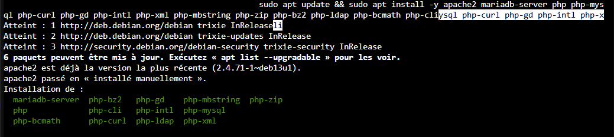
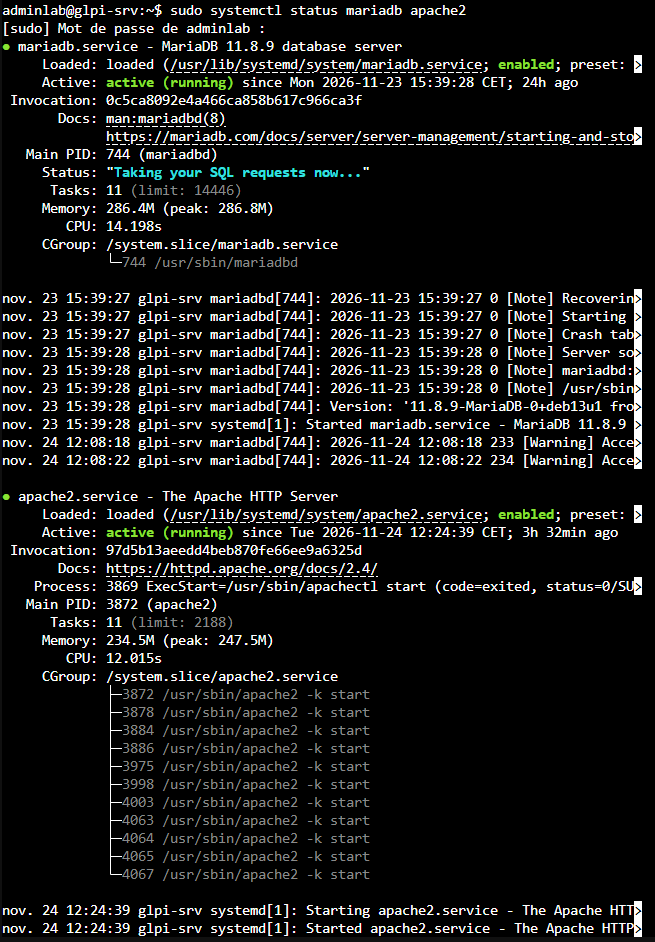
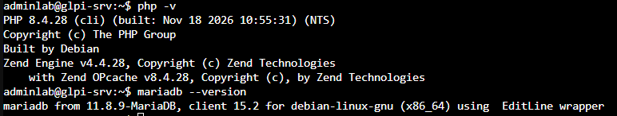
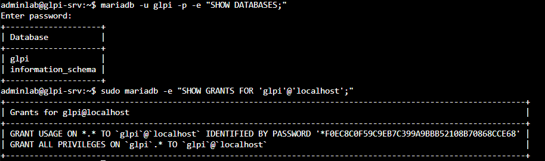

# Installation Debian et pile GLPI

Projet Support N1/N2 et virtualisation - Semaine 2 - J08 (H1 / H2 / H3) Technicien : [Aymeric] - Date : 24/11/2026 Domaine : lab.local - Serveur concerné : SRV-GLPI (192.168.56.40)

---

## Contexte

Mise en place de la pile technique nécessaire à l'hébergement du centre de services GLPI sur le serveur Debian13 `SRV-GLPI` (`192.168.56.40`) : serveur Web Apache, PHP avec les extensions requises et serveur de base de données MariaDB. 
L'objectif est de disposer d'une infrastructure fonctionnelle, isolée sur le réseau `lab.local`, avec une base de données et un compte SQL dédiés aux privilèges minimaux.

---

## H1 - Installation Debian et validation réseau / DNS

Installation et configuration initiale de la machine virtuelle `SRV-GLPI` sur le réseau isolé `192.168.56.0/24` (mode Host-Only, sans passerelle par défaut sur cette interface) :

* Nom d'hôte : `SRV-GLPI`
* Adressage IPv4 statique : `192.168.56.40` (masque `/24`, `255.255.255.0`)
* Serveur DNS : `192.168.56.10` (domaine `lab.local`)
* Vérification de l'identité système, de la configuration IP et de la connectivité vers le contrôleur de domaine `SRV-AD`

## H2 - Installation du serveur Web, de PHP et de MariaDB

Mise à jour des dépôts (via adaptateur NAT temporaire vérifié, puis désactivé) et installation de la pile LAMP requise pour la version de GLPI retenue :

```bash
sudo apt update
sudo apt install -y apache2 mariadb-server php libapache2-mod-php php-mysql php-curl php-gd php-intl php-xml php-mbstring php-bz2 php-zip php-ldap
```

### Preuve : Installation paquets nécessaire au bon fonctionnement de GLPI



Vérification de l'état des services `apache2` et `mariadb`, ainsi que des versions installées de PHP et MariaDB :

```bash
sudo systemctl status apache2 mariadb
php -v
mariadb --version
```

### Preuve : services actifs et versions relevées

Contrôle que les services `apache2` et `mariadb` sont en état `active (running)` et relevé des versions de PHP et MariaDB compatibles avec les prérequis GLPI.




---

## H3 - Création de la base de données et du compte SQL dédié

Création dans MariaDB d'une base dédiée en `utf8mb4` et d'un utilisateur SQL local (`@'localhost'`) disposant uniquement des privilèges sur cette base, sans aucun secret consigné dans la documentation :

```sql
CREATE DATABASE glpi_db CHARACTER SET utf8mb4 COLLATE utf8mb4_unicode_ci;
CREATE USER 'glpi_user'@'localhost' IDENTIFIED BY '<MOT_DE_PASSE_FORT>';
GRANT ALL PRIVILEGES ON glpi_db.* TO 'glpi_user'@'localhost';
FLUSH PRIVILEGES;
EXIT;
```

Vérification des droits accordés à l'utilisateur `glpi_user` et réalisation d'un snapshot de la VM `SRV-GLPI` en fin de séance :

```bash
sudo mariadb -e "SHOW GRANTS FOR 'glpi_user'@'localhost';"
```

### Preuve : privilèges SQL et snapshot de fin de séance

Vérification de la portée minimale des droits accordés à `'glpi_user'@'localhost'` sur `glpi_db.*` (sans affichage du mot de passe) et validation de l'instantané de la VM.


