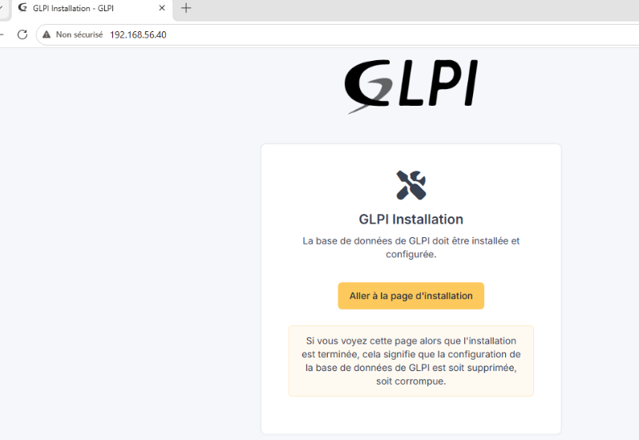
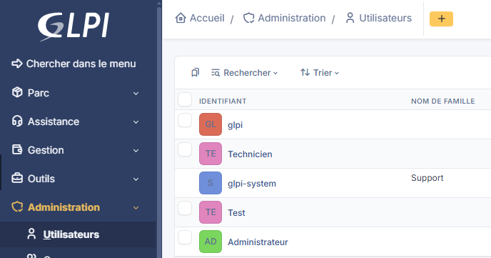

# Déploiement et sécurisation GLPI

Projet Support N1/N2 et virtualisation - Semaine 2 - J09 (H1 / H2 / H3) Technicien : [Aymeric] - Date : 24/11/2026 Domaine : lab.local - Serveur concerné : SRV-GLPI (192.168.56.40)

---

## Contexte

Déploiement applicatif de GLPI sur le serveur Debian `SRV-GLPI` (`192.168.56.40`) au sein du réseau isolé `lab.local`.
L'objectif est de valider les prérequis techniques de la version retenue, finaliser l'assistant d'installation web, sécuriser l'instance (suppression du script d'installation et gestion des comptes par défaut)
Puis structurer les entités, les profils/habilitations et les comptes de test technicien et administrateur.

---

## H1 - Installation des fichiers GLPI et vérification des prérequis

Téléchargement et extraction d'une archive GLPI maintenue dans `/var/www/glpi`, attribution des droits au serveur web (`www-data`) et contrôle des prérequis PHP et systèmes avant l'installation :

* Répertoire applicatif : `/var/www/glpi` (racine web `/var/www/glpi/public` selon la version déployée)
* Propriétaire des fichiers : `www-data:www-data`
* Correction des extensions PHP et des droits signalés sur l'écran de contrôle de l'assistant :

```bash
sudo chown -R www-data:www-data /var/www/glpi
sudo systemctl restart apache2
```

## H2 - Configuration de l'hôte virtuel, assistant et sécurisation

Configuration du VirtualHost Apache dédié à GLPI, exécution complète de l'assistant web en reliant la base `glpi_db` et l'utilisateur SQL `glpi` (créés en J08), puis sécurisation immédiate de l'instance :

* URL d'accès interne (réseau Host-Only `lab.local`) : `http://192.168.56.40`
* Suppression du script d'installation une fois l'assistant terminé :

```bash
sudo rm -f /var/www/glpi/install/install.php
```

* Modification des mots de passe et désactivation/restriction des comptes d'installation par défaut (`glpi`, `tech`, `normal`, `post-only`) depuis **Administration > Utilisateurs**, sans exposition du service sur Internet.

### Preuve : connexion à l'interface GLPI sécurisée

Accès fonctionnel à l'interface d'administration GLPI via `http://192.168.56.40` après finalisation de l'assistant et suppression de `install.php`.



---

## H3 - Comptes de test, habilitations (rôles), entités et sauvegarde

Structuration du périmètre fonctionnel et des droits dans GLPI :

* **Entités** (**Administration > Entités**) : structuration de l'arborescence pour le périmètre `lab.local`.
* **Profils et matrice des droits** (**Administration > Profils**) : vérification et ajustement des permissions par onglet (Assistance, Gestion, Administration) pour les profils *Technician* et *Admin*.
* **Comptes de test et habilitations** (**Administration > Utilisateurs**) : création des comptes de test technicien et administrateur avec attribution de leurs habilitations (association Entité + Profil + récursivité).
* **Sauvegarde** : création d'un snapshot de la VM `SRV-GLPI` une fois la configuration validée (sans aucun mot de passe consigné dans les livrables).

### Preuve : accès des comptes de test et matrice des droits

Contrôle des habilitations attribuées aux comptes de test et de la matrice des droits associée aux profils dans GLPI.




