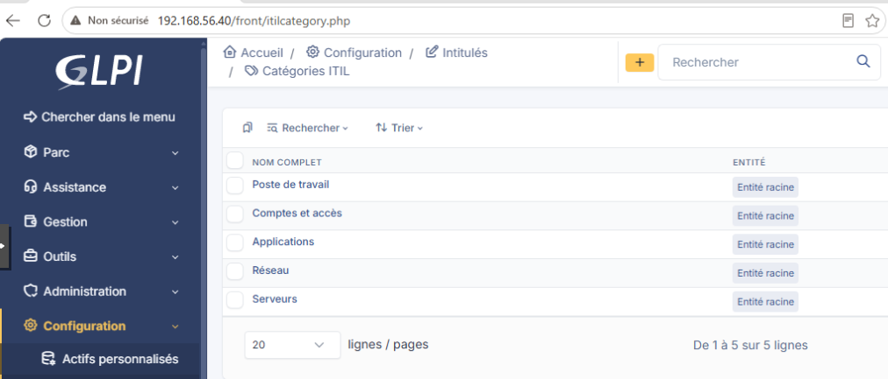
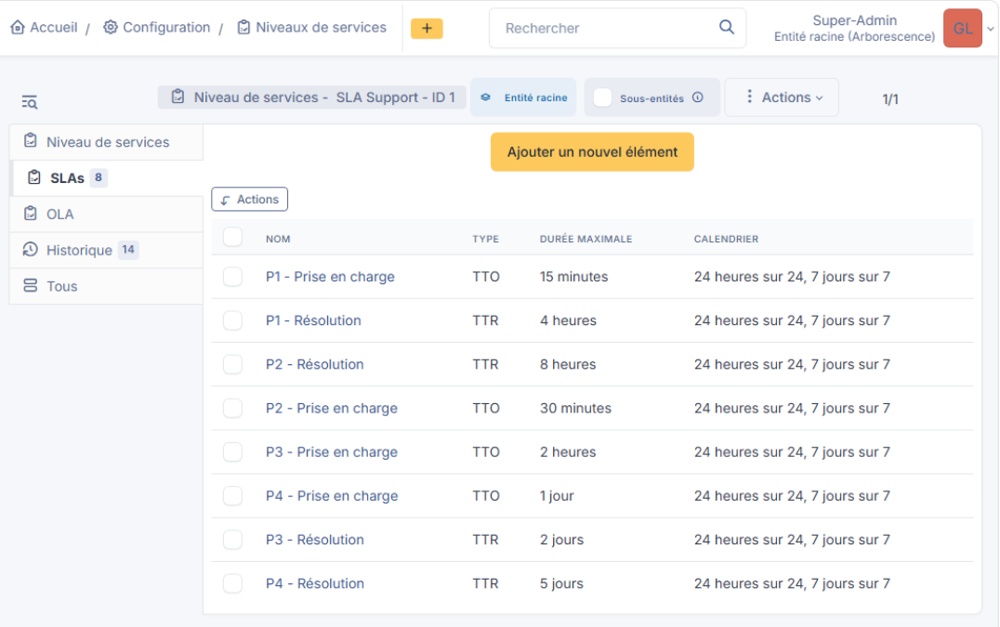
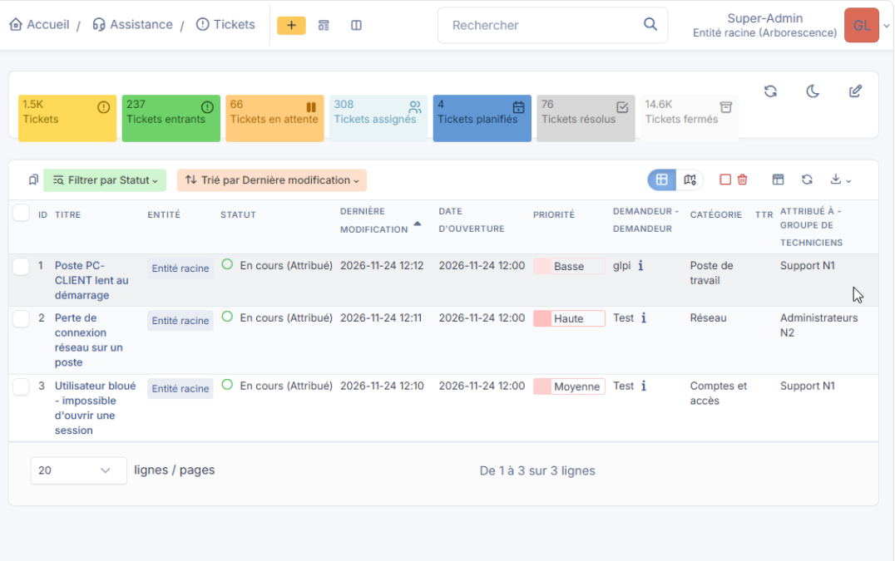

# Centre de services et qualification N1

Projet Support N1/N2 et virtualisation - Semaine 2 - J11 (H1 / H2 / H3)
Technicien : ASLAM Zishan - Date : 24/11/2026
Serveur : GLPI-SRV (192.168.56.40) - Domaine : lab.local

---

## Contexte

Transformation de GLPI en centre de services : création de la structure de traitement (groupes de support, catégories de tickets), définition de la matrice de priorité et des SLA, puis ouverture de tickets de test qualifiés. L'objectif est de pouvoir recevoir, qualifier, prioriser et router les sollicitations vers le bon niveau de support (N1 ou N2).

## H1 - Structure du centre de services

### Groupes de support

Deux groupes créés pour la chaîne d'escalade :

- `Support N1` - traitement de premier niveau (incidents courants)
- `Administrateurs N2` - escalade de deuxième niveau (incidents complexes, infrastructure)

### Catégories ITIL

Cinq catégories de tickets créées (Configuration > Intitulés > Catégories ITIL) :

- Poste de travail
- Comptes et accès
- Réseau
- Serveurs
- Applications

## H2 - Matrice de priorité et SLA

La priorité d'un ticket se calcule sur impact x urgence (jamais sur le statut du demandeur).

Accord de niveau de services (SLM) `SLA Support` contenant huit SLA. Rappel : prise en charge = TTO (Time To Own), résolution = TTR (Time To Resolve).

| Priorité | Prise en charge (TTO) | Résolution (TTR) |
|---|---|---|
| P1 | 15 min | 4 h |
| P2 | 30 min | 8 h |
| P3 | 2 h | 2 jours |
| P4 | 1 jour | 5 jours |

## H3 - Tickets de test qualifiés

Trois tickets de test ouverts, qualifiés (catégorie, priorité, demandeur) et routés vers le bon groupe :

| Ticket | Catégorie | Priorité | Groupe attribué |
|---|---|---|---|
| Poste PC-CLIENT lent au démarrage | Poste de travail | Basse (P4) | Support N1 |
| Perte de connexion réseau sur un poste | Réseau | Haute (P2) | Administrateurs N2 |
| Utilisateur bloqué - impossible d'ouvrir une session | Comptes et accès | Moyenne (P3) | Support N1 |

Le routage montre la logique d'escalade : les incidents courants (poste, compte) vont au Support N1, l'incident réseau est escaladé aux Administrateurs N2.

---

## Captures

| Fichier | Contenu |
|---|---|
| captures/categorieittilglpi.png | Les 5 catégories ITIL |
| captures/slasupportcategorie.png | Les 8 SLA (matrice P1 à P4) |
| captures/ticketglpi.png | Les 3 tickets qualifiés et routés aux groupes |
