# J12 - Traitement des incidents N1/N2

**Auteur :** Groupe
**Date :** 25/11/2026
**Semaine :** S2 - GLPI et centre de services
**Environnement :** domaine lab.local - SRV-AD (192.168.56.10), PC-CLIENT (192.168.56.20), GLPI (192.168.56.40)

## Contexte

Pour cette journée, un collègue joue le rôle du demandeur (il ouvre les tickets depuis le portail self-service de GLPI) et je joue le technicien côté Active Directory et serveur. On a traité trois incidents représentatifs du support N1/N2 : une résolution de nom qui ne fonctionne pas, un compte utilisateur bloqué, et un accès refusé à un dossier partagé.

Pour chaque incident j'ai gardé la même logique : je constate le symptôme (preuve avant), je diagnostique la vraie cause, je corrige à la source, puis je valide avec l'utilisateur (preuve après). Aucun mot de passe n'apparait dans les tickets ni dans cette fiche.

---

## Incident I-01 - Résolution de nom GLPI (DNS)

**Ticket GLPI :** [n°5]
**Catégorie :** Réseau / DNS

### Symptôme (avant)

Les utilisateurs doivent pouvoir joindre GLPI par son nom `glpi.lab.local` et pas seulement par son adresse IP. Depuis un poste, la commande `nslookup glpi.lab.local` renvoie une erreur "Non-existent domain". L'accès par l'IP `http://192.168.56.40` fonctionne, mais pas par le nom.

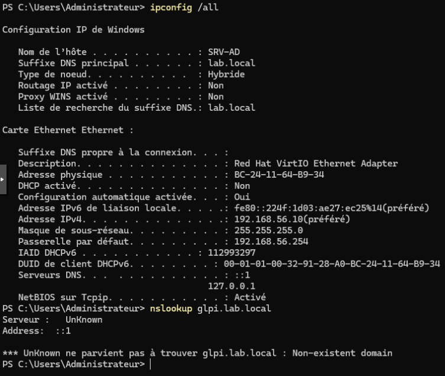

### Diagnostic

La zone de recherche directe `lab.local` existe bien et contient les enregistrements des machines du domaine (srv-ad en .10, PC-CLIENT en .20), mais il manque l'enregistrement pour `glpi`. Sans enregistrement, le serveur DNS ne sait pas traduire le nom en adresse IP, d'ou le "Non-existent domain".

### Correction

J'ai créé un enregistrement hote (A) dans la zone `lab.local` via le Gestionnaire DNS (clic droit sur la zone lab.local > Nouvel hote (A ou AAAA)), avec le nom `glpi` pointant vers `192.168.56.40`.

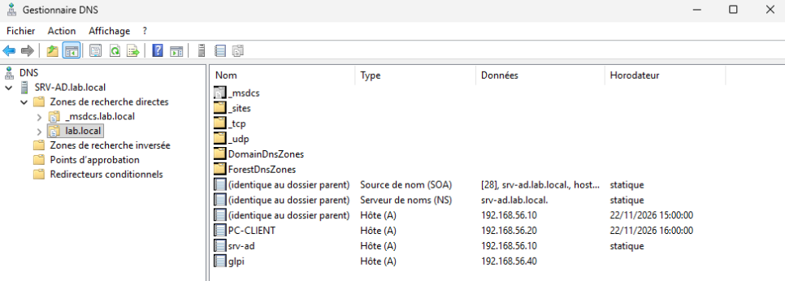

### Validation (après)

La commande `nslookup glpi.lab.local` résout maintenant correctement vers `192.168.56.40`. L'accès a l'interface GLPI par le nom de domaine fonctionne.

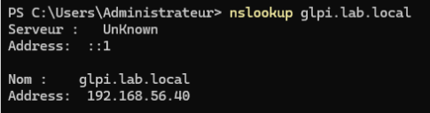

Vérification complémentaire de l'accès a l'interface, par IP puis par nom :

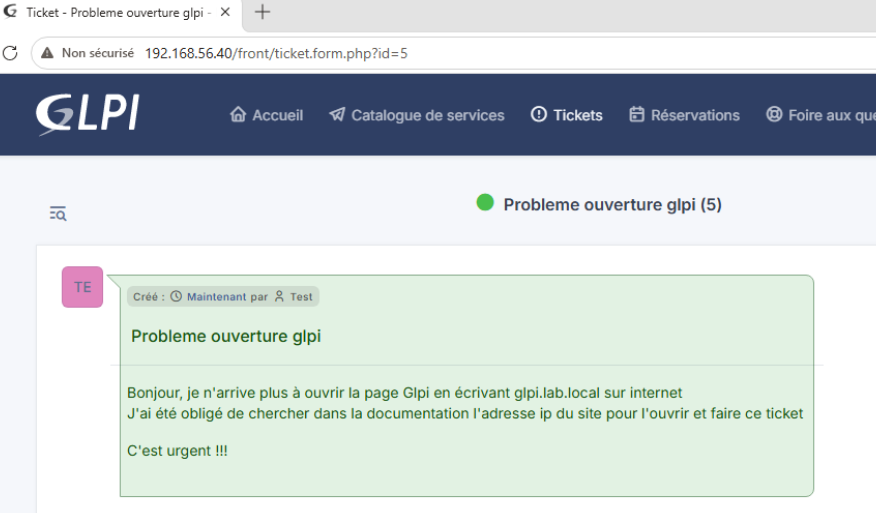

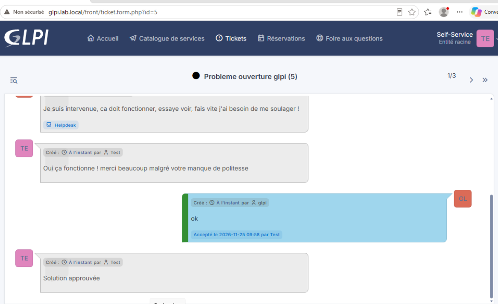

---

## Incident I-02 - Compte utilisateur désactivé

**Ticket GLPI :** [n°6]
**Catégorie :** Comptes et accès

### Symptôme (avant)

Un utilisateur (compte de test Zishtest) signale qu'il ne peut plus ouvrir sa session Windows sur PC-CLIENT. A l'ouverture de session, Windows affiche le message "Votre compte a été désactivé. Contactez l'administrateur de votre système."

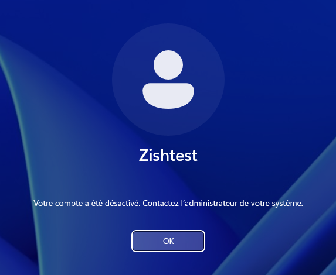

### Diagnostic

Sur SRV-AD, je vérifie l'état du compte dans l'Active Directory :

```powershell
Get-ADUser -Identity zishtest -Properties Enabled
```

La propriété `Enabled` est a `False` : le compte est bien désactivé dans l'annuaire. C'est la cause du blocage.

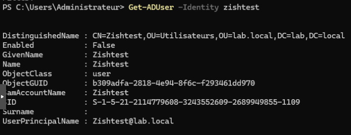

### Correction

Je réactive le compte sur SRV-AD :

```powershell
Enable-ADAccount -Identity zishtest
Get-ADUser -Identity zishtest -Properties Enabled
```

La seconde commande confirme `Enabled : True`.

### Validation (après)

L'utilisateur ouvre de nouveau sa session Windows sans erreur. L'accès est rétabli.

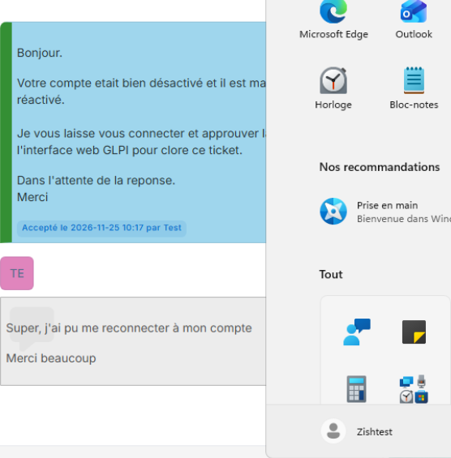

---

## Incident I-03 - Accès refusé a un dossier partagé

**Ticket GLPI :** #7
**Catégorie :** Comptes et accès / Ressources partagées

### Symptôme (avant)

L'utilisateur signale qu'il n'a plus accès au dossier partagé `\\Srv-ad\j12` qui contient des fichiers Excel de travail. En ouvrant le partage, Windows affiche "Vous n'avez pas l'autorisation d'accéder a \\Srv-ad\j12. Contactez l'administrateur réseau pour demander l'accès."

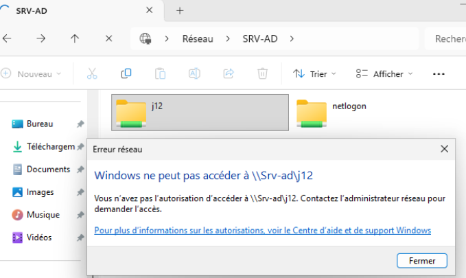

### Diagnostic

Sur SRV-AD, j'inspecte le dossier `C:\Partage-J12` (onglet Sécurité des propriétés). Les droits NTFS sont corrects : le groupe `GrpUtilisateurs` dispose déja des droits Modification et Lecture et exécution sur le dossier.

Le probleme ne vient donc pas du dossier mais de l'appartenance de l'utilisateur : le compte n'est pas membre du groupe `GrpUtilisateurs`, il ne bénéficie donc pas des droits accordés a ce groupe.

### Correction

Plutot que d'ajouter l'utilisateur directement sur le dossier, j'applique la bonne pratique (AGDLP) : j'ajoute le compte au groupe qui porte déja les droits.

```powershell
Add-ADGroupMember -Identity "GrpUtilisateurs" -Members "<compte>"
```

Point important : le jeton d'accès (liste des groupes) n'est recalculé qu'a l'ouverture de session. J'ai donc demandé a l'utilisateur de fermer puis rouvrir sa session pour que le nouveau groupe soit pris en compte.

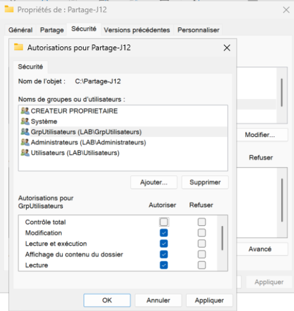

### Validation (après)

Apres reconnexion, l'utilisateur ouvre le dossier `\\Srv-ad\j12` sans erreur et accede a ses fichiers.

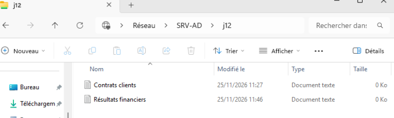

---

## Synthèse

| Incident | Cause réelle | Correction | Statut |
|----------|--------------|------------|--------|
| I-01 DNS | Enregistrement A `glpi` absent de la zone lab.local | Création de l'enregistrement hote (A) | Résolu |
| I-02 Compte | Compte désactivé dans l'AD | Enable-ADAccount | Résolu |
| I-03 Partage | Compte non membre du groupe ayant les droits | Add-ADGroupMember + reconnexion | Résolu |

Ce que je retiens de cette journée : avant de chercher un probleme compliqué, je vérifie toujours la configuration de base. Les trois incidents avaient une cause simple (un enregistrement manquant, un compte désactivé, une appartenance de groupe manquante) et pas un bug logiciel. Le réflexe diagnostic (constater, vérifier a la source, corriger, valider avec l'utilisateur) fonctionne pour les trois.
