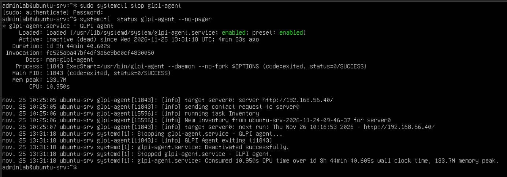
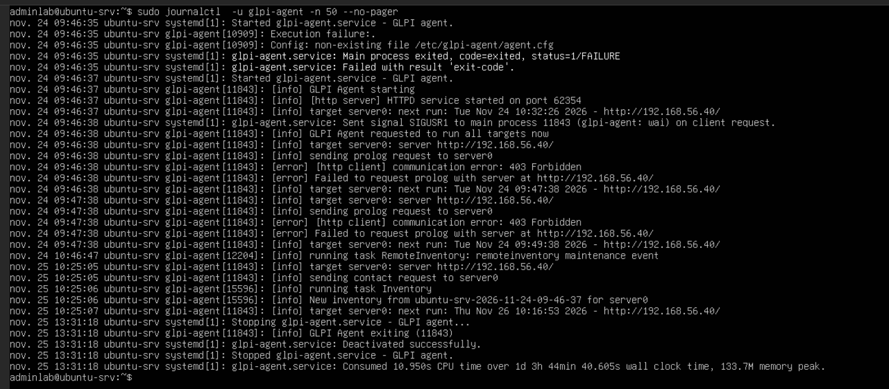
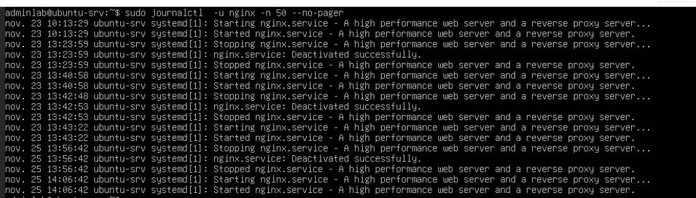
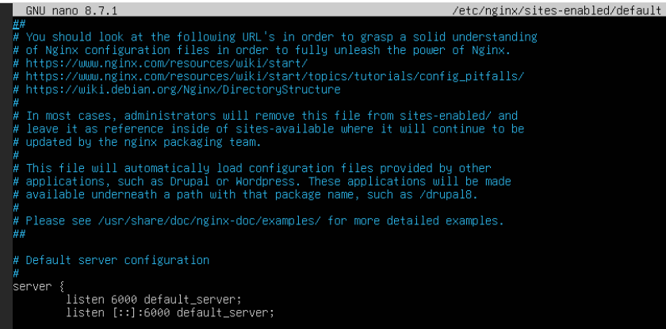
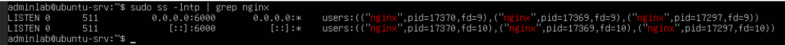
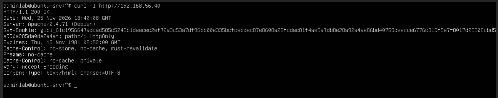
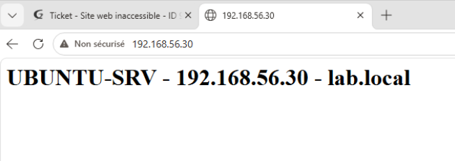

# J13 - Incidents Linux et GLPI Agent (N1/N2)

**Auteur :** GROUPE
**Date :** 25/11/2026
**Semaine :** S2 - GLPI et centre de services
**Environnement :** lab.local (Proxmox) - serveur GLPI 192.168.56.40, serveur Ubuntu 192.168.56.30

## Contexte

Pour cette journée, nous avons deux incidents côté Linux : l'arrêt de la remontée d'inventaire de l'agent GLPI (I-04), et l'indisponibilité du service Web de l'Ubuntu (I-05). Pour chaque incident, nous avons suivi la même logique : constater le symptôme (preuve avant), diagnostiquer la vraie cause, corriger à la source, puis valider (preuve après). Aucun mot de passe n'apparait dans les tickets ni dans cette fiche.

---

## Incident I-04 - Agent GLPI arrêté : plus de remontée d'inventaire

**Ticket GLPI :** [n°]
**Catégorie :** Inventaire / Agent GLPI

### Symptôme (avant)

La machine ne remonte plus dans GLPI, l'inventaire ne se met plus à jour. Sur la machine, le service `glpi-agent` est à l'arrêt.

```bash
systemctl status glpi-agent
```



### Diagnostic

Je consulte les journaux de l'agent pour confirmer l'arrêt et écarter une erreur de configuration ou un problème réseau :

```bash
journalctl -u glpi-agent -n 50
curl -I http://192.168.56.40
```

Le `curl` vers le serveur GLPI répond bien (code HTTP valide), donc le serveur et le réseau sont corrects : la cause est bien l'agent local arrêté.



### Correction

Je redémarre l'agent, je l'active au démarrage et je force une remontée :

```bash
sudo systemctl start glpi-agent
sudo systemctl enable glpi-agent
sudo glpi-agent --force
```

### Validation (après)

Côté interface GLPI, la fiche de la machine montre une date de dernier inventaire remise à jour. La remontée est de nouveau opérationnelle.


---

## Incident I-05 - Service HTTP Ubuntu indisponible (mauvais port nginx)

**Ticket GLPI :** [n°]
**Catégorie :** Services / Web

### Symptôme (avant)

Le site de l'Ubuntu (`http://192.168.56.30`) ne répond plus. Côté client, la page ne charge pas et `curl` échoue.


### Diagnostic

Je regarde l'état du service, puis les ports en écoute :

```bash
systemctl status nginx
ss -lntp
```

Point important du diagnostic : le service nginx est bien `active (running)`. Le service tourne, mais il n'écoute **pas sur le port 80**, il écoute sur un mauvais port (erreur de configuration). C'est ce qui rend l'incident intéressant : il ne faut pas se fier au seul état du service, il faut vérifier le **port**.







### Correction

Je corrige la directive d'écoute dans la configuration nginx pour rétablir le port 80, je teste la syntaxe, puis je recharge :

```bash
sudo nginx -t
sudo systemctl reload nginx
```

`nginx -t` doit répondre `syntax is ok` et `test is successful` avant le rechargement.

### Validation (après)

Le port 80 est de nouveau en écoute, le site répond.

```bash
curl -I http://192.168.56.30
```





---

## Synthèse

| Incident | Cause réelle | Correction | Statut |
|----------|--------------|------------|--------|
| I-04 Agent GLPI | Service `glpi-agent` arrêté | `systemctl start` + `--force` | Résolu |
| I-05 HTTP Ubuntu | nginx à l'écoute sur un mauvais port (erreur de config) | Rétablir `listen 80` + `reload` | Résolu |

Ce que nous retenons : pour les deux incidents, le réflexe gagnant c'est de distinguer les chaines techniques. Pour I-04, agent local arrêté alors que le serveur GLPI répondait. Pour I-05, service bien démarré mais sur le mauvais port. Dans les deux cas, regarder au bon endroit (le port, le bon service) évite de conclure trop vite à une panne plus grave.
